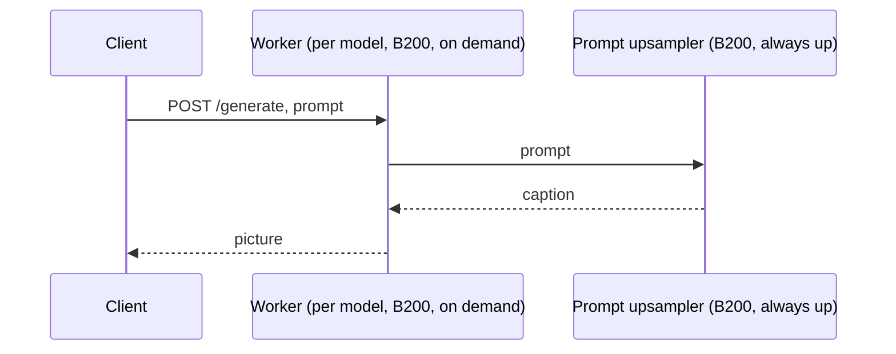

# FLUX.3 Klein on Modal, shared prompt upsampler

[FLUX.3 Klein](https://huggingface.co/black-forest-labs/flux-3-image-klein) (Distilled, [Base](https://huggingface.co/black-forest-labs/flux-3-image-klein-base), or Base with a LoRA) as authenticated HTTP endpoints on Modal, with the [prompt upsampler](https://huggingface.co/black-forest-labs/flux-3-image-klein-pup) running once for all of them. Text to image, editing with references, layout boxes, captions, JPEG or PNG.

## Architecture

Two Modal apps:

- The **prompt upsampler**: Black Forest Labs' 9B language model that turns a short prompt into the detailed caption the image model expects. One B200, always up.
- A **worker** per model: the image model, one B200 per container, the URL clients call. Starts on demand, stops after 120 s idle, restores from a GPU memory snapshot, answers 503 while it starts.



The caption takes about 1.3 s, the picture 0.7 s (Distilled) or 3.3 s (Base). A request that carries a `caption` skips the prompt upsampler. An [optional router](#optional-router) can take the request instead and hold it while the worker starts.

## Against one container per replica

The alternative, [flux-3-klein-serving](https://github.com/nicolaslara/flux-3-klein-serving), runs both models on every B200. Distilled, 1024x1024, same day:

| | One container per replica | Shared prompt upsampler |
|---|---|---|
| Per picture, warm, one client | 2.0 s | 2.2 s |
| Cold start with a snapshot, to the first picture | 33 s | 12 to 22 s |
| Cold start without a snapshot | 9 min | 4 to 9 min |
| Burst from zero at 1.5 requests per second, first picture | 35 s | 17 s |
| Most pictures per second on three B200 | 1.8 | 2.8 |
| $ per 1,000 pictures at that rate | 3.20 | 2.06 |
| Kept warm, per hour | $6.95 per container | $6.70 prompt upsampler + $6.95 per worker |

A worker's snapshot holds only the image model, so it restores faster. A worker makes 1.5 pictures per second against 0.7 for a container running both models. The prompt upsampler is a fixed $6.70 per hour, so one worker costs about the same per picture as one container and every further worker a third less. One quiet endpoint is cheaper as one container per replica.

`upsampler.py` is the prompt upsampler, `worker.py` the worker, `flux3_api.py` the request handling, `router.py` the optional router, `requirements-pup.txt` the prompt upsampler's locked environment.

## Quick start

Accept the terms on Hugging Face for the model and the prompt upsampler, then deploy in this order:

```
uv sync
uv run modal setup
uv run modal secret create huggingface HF_TOKEN=hf_...
uv run modal deploy upsampler.py
uv run modal deploy worker.py
```

The first deploys build the images (19 GB and 16 GB). The worker's build ends with a GPU step of about three minutes that runs the engine once and keeps its kernel caches. The worker's deploy prints its URL; export it with a proxy auth token from the Modal dashboard (Settings, Proxy Auth Tokens):

```
export URL=https://<workspace>-<environment>--flux3-klein-distilled-shared-server.us-east.modal.direct
export MODAL_KEY=wk-...
export MODAL_SECRET=ws-...
```

While no worker is up, every request gets an immediate 503 and starts one. Poll `/wake` until it answers 200, then send `/generate` once; a non-200 means no picture was made.

```
until curl -sf -o /dev/null -X POST -H "Modal-Key: $MODAL_KEY" -H "Modal-Secret: $MODAL_SECRET" $URL/wake; do sleep 5; done
curl -sf -H "Modal-Key: $MODAL_KEY" -H "Modal-Secret: $MODAL_SECRET" \
  --json '{"prompt": "Two blue mugs on a wooden table by a window", "seed": 42}' \
  $URL/generate -o image.jpg
```

## API

`POST /generate`, JSON body. Unknown fields are rejected.

| field | default | notes |
|---|---|---|
| `prompt` | | Expanded by the prompt upsampler. Exactly one of `prompt` and `caption` |
| `caption` | | An already expanded caption, used as is |
| `images` | `[]` | Up to ten base64-encoded reference images, each up to 10 MB |
| `width`, `height` | 1024, or the first reference's size | Multiples of 16, up to 4096 per side and 4 megapixels |
| `seed` | `0` | Same seed and same `caption`, same picture on the same GPU model; a `prompt` is expanded afresh each time, so send back the `X-Caption` header as `caption` to reproduce a picture |
| `steps` | 16 Distilled, 50 Base | 1 to 100 |
| `guidance` | 3.5 on Base | 0 to 20. Not used by Distilled |
| `output_format` | `jpeg` | `jpeg` (quality 95) or `png` |

The response is the picture; `X-Pup-Ms`, `X-Upsampler-Ms` and `X-Image-Ms` headers give the expansion, its part inside the prompt upsampler, and the generation time, `X-Caption` the caption URL-encoded. 422 is an invalid request (the body says what), 429 a worker holding 16 requests (retry), 502 a prompt upsampler or engine failure, 503 no worker up, 504 the 300 s deadline.

Editing: the reference pictures go base64-encoded in `images`. The body is too large for a command-line argument, so write it to a file:

```
printf '{"prompt": "Make the mugs red", "images": ["%s"], "output_format": "png"}' "$(base64 < image.jpg | tr -d '\n')" > edit.json
curl -sf -H "Modal-Key: $MODAL_KEY" -H "Modal-Secret: $MODAL_SECRET" --json @edit.json $URL/generate -o edit.png
```

Layouts: end the prompt with a JSON list of boxes, `[y_min, x_min, y_max, x_max]` on a 0 to 1000 canvas, origin top left:

```
{"prompt": "A blue mug on the left [{\"id\": \"mug\", \"bbox\": [200, 100, 800, 450], \"desc\": \"blue mug\"}]", "seed": 42}
```

## Cold starts and scaling

A worker stops 120 s after its last request, and the next request starts one: 12 to 22 s with a snapshot, four to nine minutes without one (the first start after a deploy, or on a new kind of worker). To keep a worker up:

```
uv run modal run worker.py --warm 1
```

A worker renders one picture at a time, lets the next request's encoding overlap it, and holds up to 16 requests. Beyond that Modal queues and adds workers, up to `REPLICAS`. One prompt upsampler fed three workers with headroom.

## Configuration

Environment variables read at deploy time, for example `MODEL=base REPLICAS=4 uv run modal deploy worker.py`. A redeploy with the same code and settings keeps the snapshot.

`upsampler.py`:

| variable | default | notes |
|---|---|---|
| `GPU` | `B200` | H200 is $1.70 per hour cheaper and 0.4 s slower per expansion |
| `APP_NAME` | `flux3-upsampler` | |

`worker.py`:

| variable | default | notes |
|---|---|---|
| `MODEL` | `distilled` | `distilled` or `base`; separate apps |
| `LORA_REPO` | unset | Base only: Hugging Face repo with one safetensors adapter, `org/name[@revision]`; not measured |
| `GPU` | `B200` | `B200`, `H200`, `H100` or `H100!` |
| `WARM` | `0` | Workers kept up; `modal run worker.py --warm N` changes it without a redeploy |
| `REPLICAS` | `1` | Most workers, up to 16 |
| `IDLE_SECONDS` | `120` | How long an idle worker stays up |
| `SNAPSHOT` | `1` | `0` makes every start fresh |
| `HIGH_RES` | `0` | Distilled on B200 only: text to image up to 6256 per side, one request at a time |
| `UPSAMPLER_APP` | `flux3-upsampler` | The prompt upsampler app, same environment |
| `MAX_INFLIGHT` | `16` | Requests a worker holds before answering 429 |
| `IMAGE_SLOTS` | `2` | Requests at the image engine at once |

## Optional router

`router.py` is a CPU app, always up, that clients can call instead of a worker. It expands the prompt while the worker starts and holds the request instead of answering 503. It costs a container, a proxy token and 0.1 s per picture, and saves 1.3 s on a cold start. Use it when clients cannot poll `/wake`.

```
uv run modal secret create flux3-router MODAL_KEY=wk-... MODAL_SECRET=ws-...
uv run modal deploy router.py
```

The body takes one more field, `model`: `distilled`, `base` or a name from `WORKERS`.

| variable | default | notes |
|---|---|---|
| `WORKERS` | unset | Extra names, `mylora=flux3-klein-base-lora-shared,...` |
| `UPSAMPLER_APP` | `flux3-upsampler` | |
| `APP_NAME` | `flux3-router` | |

## Measurements

Distilled, 1024x1024, unique prompts, everything in `us-east`, requests arriving independently at the given rate; p50 and p95 are request to picture, waiting included.

| workers | requests per second | pictures per second | p50 / p95 | $ per 1,000 pictures |
|---|---|---|---|---|
| 1 worker | 1.5 | 1.27 | 2.8 / 4.1 s | 3.00 |
| 2 workers | 3.0 | 2.78 | 4.2 / 7.1 s | 2.06 |
| 3 workers | 4.0 | 3.75 | 3.1 / 5.0 s | 2.04 |

Three one-container replicas on the same three B200 deliver at most 1.8 pictures per second. Base: 4.7 s per picture warm, 18 pictures per minute on one worker.

Cold starts, request to the first picture:

| | Distilled | Base |
|---|---|---|
| With a snapshot | 12 to 22 s | |
| Without a snapshot | 214 to 305 s | 289 s |

The kernel caches in the image take 20 to 35 s off the engine's warmup. The engine releases its allocator cache during the warmup, which keeps the snapshot at 24 GB instead of 30 GB. Pictures are byte-identical with and without both, and warm throughput is unchanged.
